<p align="center">
  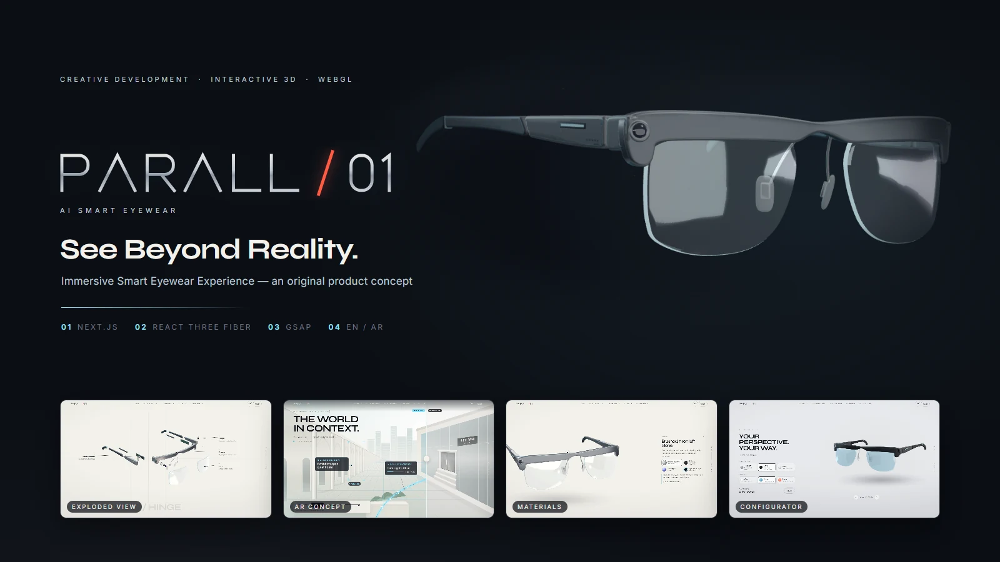
</p>

<h1 align="center">PARALL / 01</h1>
<p align="center"><b>Immersive Smart Eyewear Experience</b><br><i>See Beyond Reality.</i></p>

<p align="center">
  <a href="https://parall-01.vercel.app"><b>Live experience</b></a> &nbsp;·&nbsp;
  <a href="docs/CASE_STUDY.md"><b>Case study</b></a> &nbsp;·&nbsp;
  <a href="docs/media/preview.mp4"><b>Motion preview (MP4)</b></a>
</p>

---

PARALL / 01 is an original, single-page product film for a **conceptual** pair of AI/AR smart glasses. One persistent WebGL scene carries an original Blender-built eyewear model through eight scroll-directed scenes: a cinematic reveal, an exploded engineering view, contextual intelligence, an augmented-reality comparison, an editorial interlude, material exploration, a live configurator and a closing statement. It runs in English and in fully mirrored Arabic.

> PARALL / 01 is a fictional concept built as a creative-development portfolio piece. It is not a commercial product: nothing is for sale, and the AI/AR features are demonstrations, not real integrations.

<p align="center">
  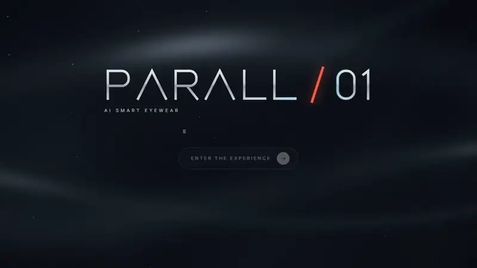
  <br><sub>Real capture of the production build (12 fps preview; full-quality <a href="docs/media/preview.mp4">MP4</a>).</sub>
</p>

## Highlights

| | |
|---|---|
| **Cinematic 3D product** | An original eyewear model (34 named parts, 115k triangles, 468 KB Draco GLB) generated in Blender from a version-controlled script, rendered in real time with brushed titanium, optical glass and calibrated AgX tone mapping. |
| **Scroll-driven storytelling** | One camera choreography across the whole page. Shots are authored as *screen compositions* and solved for every aspect ratio, so the product keeps clear of the text from ultra-wide desktops to phones. Scrolling back replays the film exactly in reverse. |
| **Reversible GSAP typography** | A small `data-motion` vocabulary — masked line rises, word reveals, tracking settles, cascades, a scrubbed finale — turned into ScrollTriggers that play on the way down and reverse on the way up. |
| **Exploded engineering view** | Components separate in 3D while annotations lay themselves out beside the product, connected by leader lines to the exact parts; on narrow screens they become lettered pins and a legend. |
| **AR concept experience** | A Normal / PARALL comparison over an original SVG city scene: a self-drawing route, object tracking, a perspective-correct translated sign and contextual cards, with a divider that tracks the pointer within 2 px. |
| **Material exploration** | Each material sample moves the camera to its real component (frame, temple tip, lens, status light), emphasises it in the live materials and pins it on screen. |
| **Configurator** | Three finishes and three lens tints mutate the same model in real time; drag, arrow keys and touch rotate it. |
| **Enter experience** | A live atmospheric prologue (shader ribbons, haze, dust) with an honest progress line; at 100 % an Enter screen starts the experience with or without sound. |
| **Original soundtrack** | Composed and rendered for this project in code — a 9 s opening swell and a 96 s seamless loop — played through a single Web Audio graph. |
| **English + Arabic RTL** | Complete Arabic translation in Tajawal, mirrored compositions, Arabic-safe text animation (letters are never split) and language-aware annotation layouts. |

## Gallery

<table>
<tr><td colspan="2">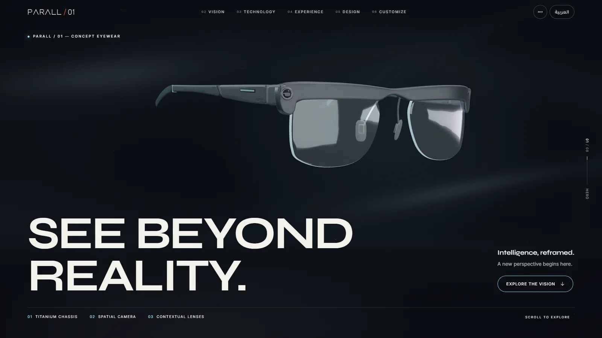<br><sub><b>Hero</b> — the product settles into its opening composition after Enter.</sub></td></tr>
<tr>
<td width="50%">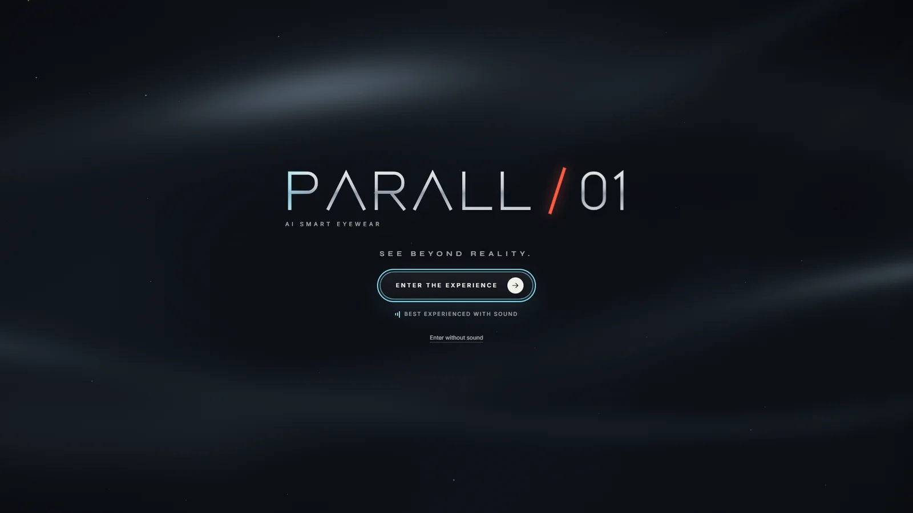<br><sub><b>Enter</b> — live atmosphere, wordmark, sound or silent entry.</sub></td>
<td width="50%">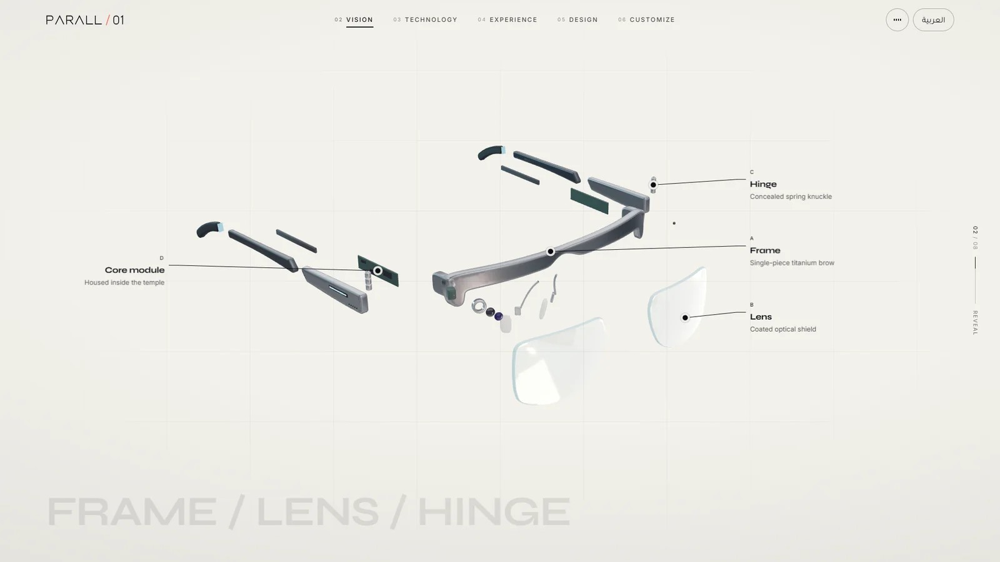<br><sub><b>Exploded view</b> — annotations laid out beside the product.</sub></td>
</tr>
<tr>
<td>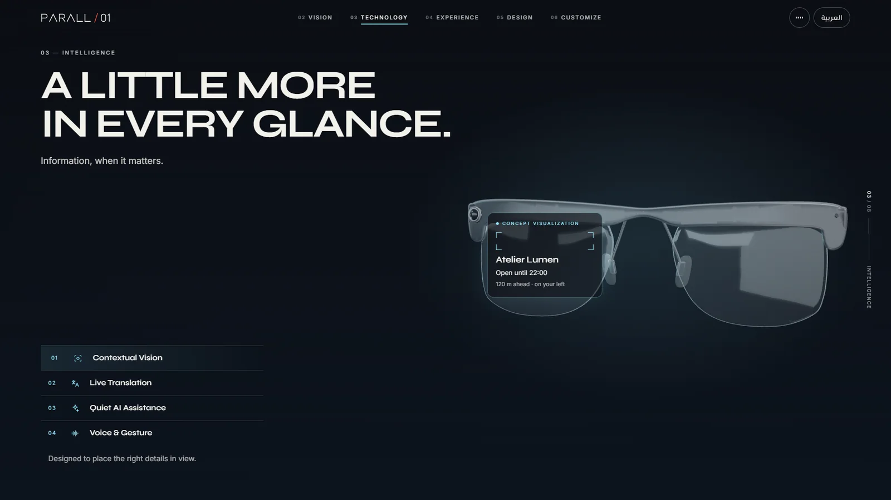<br><sub><b>Intelligence</b> — concept HUD projected inside the lens.</sub></td>
<td>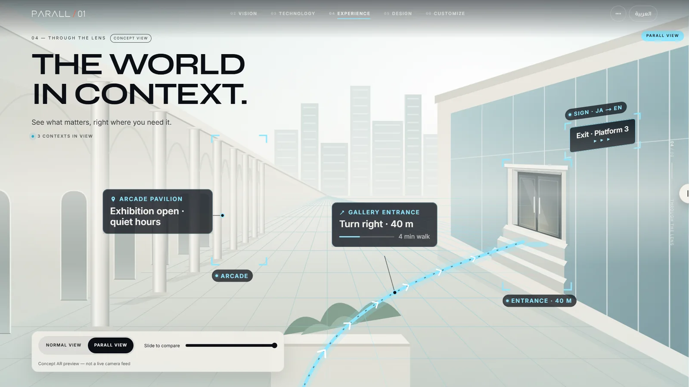<br><sub><b>Through the lens</b> — route, tracking and translated signage.</sub></td>
</tr>
<tr>
<td>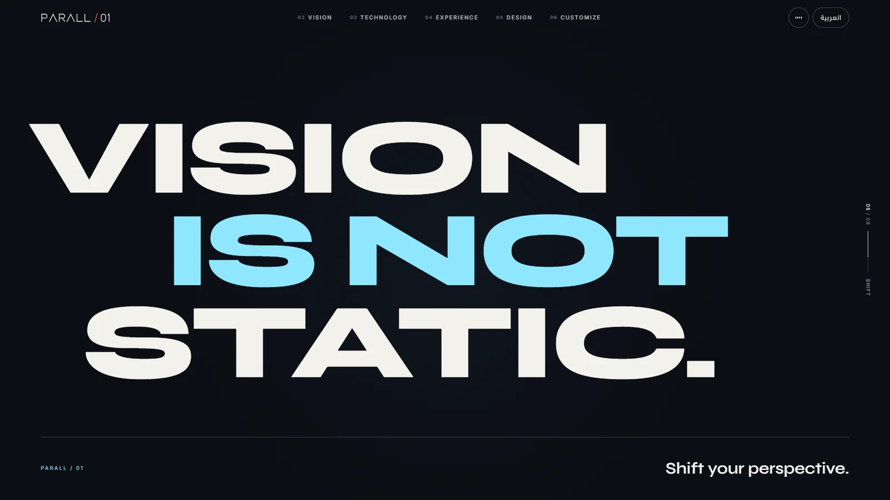<br><sub><b>Perception shift</b> — editorial type in three measured zones.</sub></td>
<td>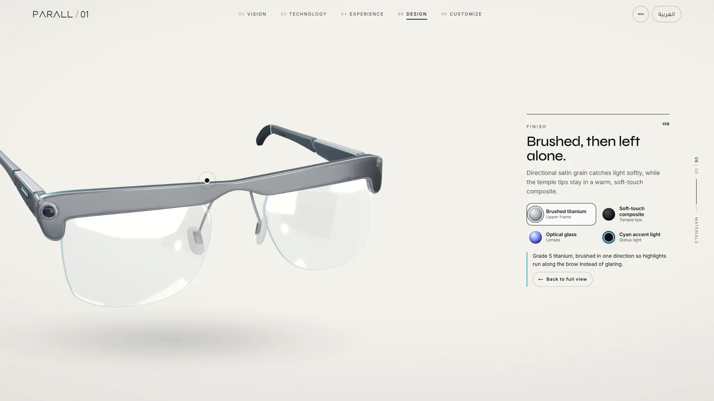<br><sub><b>Materials</b> — sample selected, camera on the brushed brow.</sub></td>
</tr>
<tr>
<td>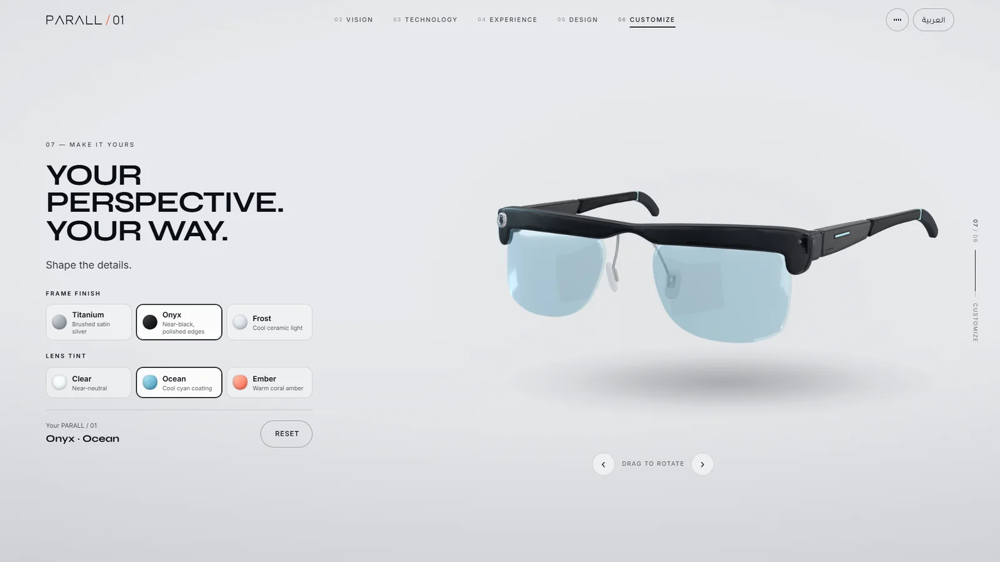<br><sub><b>Configurator</b> — Onyx finish, Ocean tint, live.</sub></td>
<td>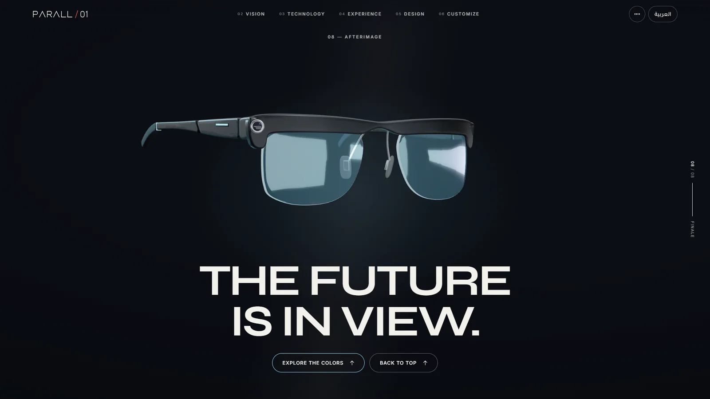<br><sub><b>Finale</b> — the closing statement builds as you scroll.</sub></td>
</tr>
<tr>
<td>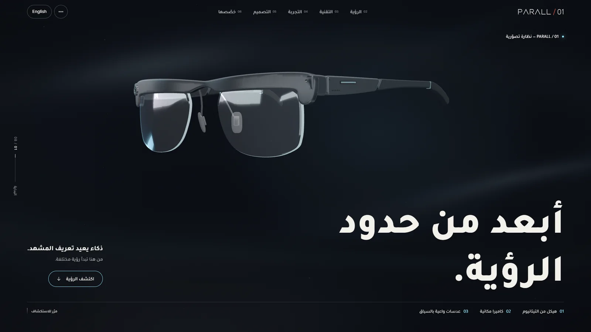<br><sub><b>Arabic (RTL)</b> — mirrored composition and Tajawal typography.</sub></td>
<td>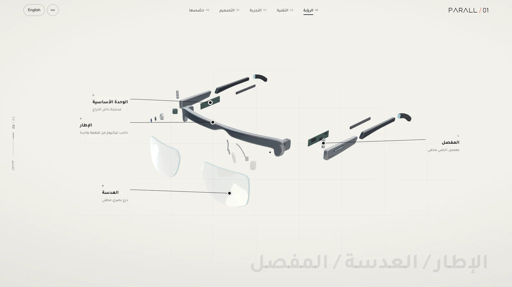<br><sub><b>Arabic exploded view</b> — labels aligned toward the product.</sub></td>
</tr>
<tr><td colspan="2">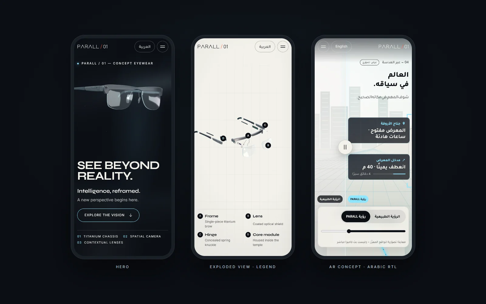<br><sub><b>Mobile</b> — re-composed for portrait, not scaled down.</sub></td></tr>
</table>

## Technology

| Area | Used |
|---|---|
| Framework | Next.js 16 (App Router, static `/en` + `/ar`), React 19, TypeScript (strict) |
| 3D | Three.js r187, React Three Fiber 9, Drei (GLTF + Draco, Environment, Lightformers, PerformanceMonitor) |
| Motion | GSAP 3 + ScrollTrigger, Lenis smooth scrolling |
| Styling | Tailwind CSS 4 (PostCSS) with hand-written CSS for the editorial system; Syne, Inter, Tajawal via `next/font` |
| State | Zustand |
| Content pipeline | Blender 5 (Python generator → Draco GLB), Node + FFmpeg (soundtrack rendering, Opus/AAC encoding) |
| Quality | ESLint, TypeScript, Playwright-driven visual and interaction suites |

## Engineering highlights

- **Deterministic camera.** The product pose is a pure function of scroll position, aspect ratio and language. Shot markers are re-measured whenever the page layout changes, and the intro is time-derived, so no navigation path (anchors, reload, resize, language switch, fast flings) can leave the model in a stale pose. 21 navigation flows were tested against a fresh load with zero pose difference.
- **No first-frame stall.** The old prologue sat at 99 % while the first visible frame compiled shaders and built an extra transmission pass for one tiny material. Programs now compile asynchronously (`KHR_parallel_shader_compile`), a one-pixel warm-up draw uploads buffers and textures behind the progress line, and the transmission pass is gone. The longest frame gap after Enter went from 2.8 s to roughly 0.1–0.4 s in measured runs.
- **Compositions, not coordinates.** Every shot defines where its focus point sits on screen and how much of the width and height the product may take; a camera-relative solve produces the 3D pose for the current viewport and mirrors it for RTL.
- **Overlays that know the model.** The render loop publishes projected component positions and a tight screen rectangle; DOM annotations, the material-focus pin and the ground shadow all follow the real geometry.
- **Interaction latency first.** The AR divider is written straight to the DOM on every pointer event; heavy SVG plazas are memoised; scroll progress is applied to the few elements that need it instead of an inherited CSS variable that would restyle thousands of nodes per frame.
- **Accessible by default.** Semantic landmarks, keyboard-operable controls (feature chips, AR slider, configurator, material samples), visible focus, `aria-pressed`/`aria-current`, a silent-entry option and a complete reduced-motion mode.

Read the full write-up in **[docs/CASE_STUDY.md](docs/CASE_STUDY.md)**.

## Getting started

Requirements: Node.js 20 or newer (developed with Node 24) and npm.

```bash
git clone https://github.com/Youssef-Elalfy/parall-01.git
cd parall-01
npm install
npm run dev          # http://localhost:3000  → redirects to /en  (Arabic: /ar)
```

```bash
npm run lint         # ESLint
npm run typecheck    # tsc --noEmit
npm run build        # production build (static /en and /ar)
npm run start        # serve the production build
```

No environment variables or API keys are required. `NEXT_PUBLIC_SITE_URL` optionally overrides the canonical/Open Graph origin; on Vercel the production domain is detected automatically.

<details>
<summary><b>Browser QA suites</b> (Playwright, run against <code>npm run dev</code>)</summary>

Install the browser once with `npx playwright install chromium`, then:

```bash
node scripts/qa-visual.mjs --tag check        # 10 viewports × EN/AR, overlap / overflow audit + screenshots
node scripts/qa-interactions.mjs --tag check  # pose determinism, nav, sound, configurator, AR, locale, mobile menu
node scripts/qa-motion.mjs [--lang ar]        # every scroll animation: reveal ↓, reverse ↑, replay ↓
node scripts/qa-materials.mjs                 # each material sample frames its real component
node scripts/qa-ar.mjs                        # AR compare: pointer tracking, parallax latency, touch, reversal
node scripts/qa-intro.mjs --tag intro         # prologue → Enter → hero: progress, long tasks, audio
node scripts/smoke-live.mjs --base https://parall-01.vercel.app   # deployed site: audio, scroll, AR, materials, configurator, mobile
```
Results are written to `qa/` (not committed).
</details>

<details>
<summary><b>Project structure</b></summary>

```
src/app/[locale]/            layout (fonts, metadata, lang/dir) and page — /en, /ar
src/components/Experience.tsx  client shell: locale, scroll engine, scene director, text motion
src/components/sections/     Hero, Reveal, Intelligence, ARExperience (+ ARWorld), EditorialShift,
                             Materials, Configurator, Finale
src/components/three/        ProductCanvas (renderer, studio, camera director, shadow),
                             SmartGlasses (GLB rig, live materials, explode, anchors), Atmosphere
src/components/layout/       Loader (prologue + Enter), TopNav, ScrollProgress
src/lib/animation/           shots (compositions), scrollState, useScrollEngine, textMotion
src/lib/                     sound (Web Audio engine), readiness (honest loading progress), i18n
public/models  public/audio  public/draco      runtime assets (served locally, no CDN)
blender/                     model generator + editable .blend
audio/compose.mjs            soundtrack source (see audio/README.md)
scripts/                     QA and showcase capture tooling
docs/CASE_STUDY.md           project case study;   docs/media/  real captures
```
</details>

## Credits

All design, code, 3D, illustration and sound in this repository are original work for PARALL / 01.

| Asset | Source | License |
|---|---|---|
| Eyewear model (`public/models/parall-01.glb`) | Generated by `blender/build_parall01.py` | Original |
| Soundtrack (`public/audio/*`) | Composed and rendered by `audio/compose.mjs` — no samples or third-party music | Original |
| AR scene, wordmark, atmosphere shader | Hand-authored SVG / vector / GLSL | Original |
| Syne, Inter, Tajawal | Google Fonts via `next/font` (self-hosted at build) | SIL Open Font License 1.1 |
| Draco decoder (`public/draco/`) | three.js `examples/jsm/libs/draco` | Apache-2.0 |

Full asset notes: [ASSET_CREDITS.md](ASSET_CREDITS.md) · soundtrack details: [audio/README.md](audio/README.md).

## License

No open-source license has been granted. The source is published for viewing and evaluation; all rights are reserved by the author. Please get in touch before reusing code, models, audio or imagery.

---

<p align="center"><sub>Designed and engineered by <a href="https://github.com/Youssef-Elalfy">Youssef-Elalfy</a>.</sub></p>
