# PARALL / 01 — Engineering an Immersive Digital Eyewear Experience

<p align="center">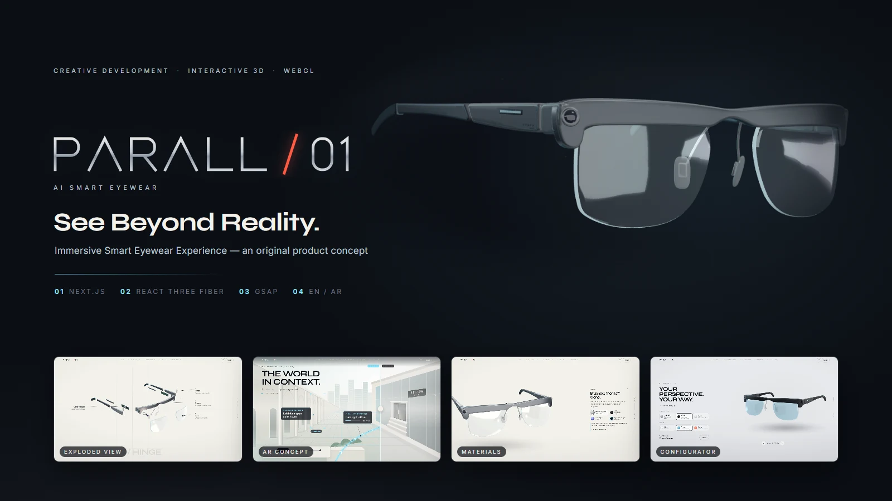</p>

**Role:** creative direction, 3D, design and front-end engineering · **Type:** original concept, portfolio project · **Stack:** Next.js 16, React 19, TypeScript, Three.js / React Three Fiber, GSAP + ScrollTrigger, Lenis, Blender, Web Audio · **Live:** [parall-01.vercel.app](https://parall-01.vercel.app)

> PARALL / 01 is a fictional product. No hardware exists, nothing is for sale, and the AI/AR features are illustrations of an idea — not integrations.

---

## 1. Project Overview

PARALL / 01 is a single-page product film for an imagined pair of AI/AR smart glasses. The visitor scrolls one continuous story, and a single persistent 3D model is the camera's subject throughout:

1. **Hero** — the product glides out of the dark.
2. **Reveal** — front view, then an exploded engineering view, then a macro of the camera module.
3. **Intelligence** — four concept features, with a HUD projected inside the real lens.
4. **Through the lens** — the camera dives through a lens into an AR comparison of a city plaza.
5. **Perception shift** — an editorial typographic interlude.
6. **Design & materials** — form, finish and feel, with interactive material samples.
7. **Configurator** — finishes and lens tints on the live model.
8. **Finale** — the closing statement.

The goal was a portfolio piece that holds up to inspection on every axis: art direction, a believable product, motion that behaves under any navigation, Arabic as a first-class language, measured performance and verified behaviour.

## 2. Creative Vision

The brief was *futuristic luxury with editorial restraint*: product CGI that reads as a commercial render, typography with real confidence, and motion that serves the story rather than decorating it. The palette is deliberately small — obsidian `#0B0E14`, ivory `#F3F1EB`, titanium `#BFC7D1`, graphite `#6E7480`, an ice-cyan signal `#8FE7FF` and a single coral accent `#FF5B43`. Dark scenes carry the drama; ivory scenes carry the engineering and material story.

<p align="center">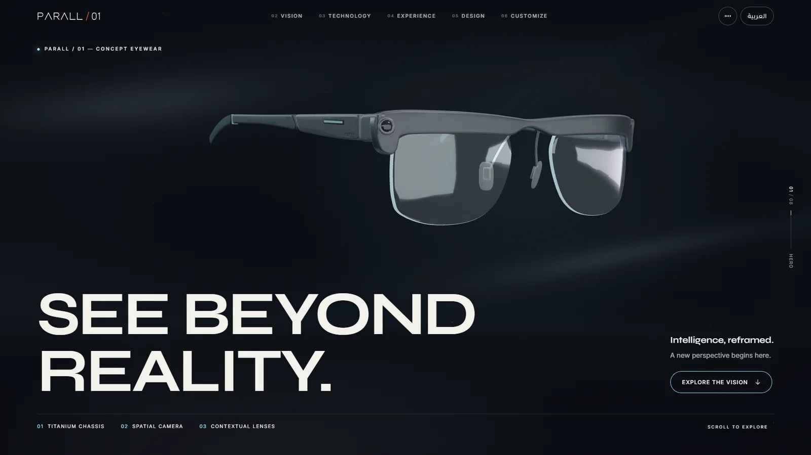</p>

## 3. The Design Challenge

A scroll-driven 3D story is easy to make impressive at one window size and fragile everywhere else. The real challenges were:

- **One model, many compositions.** The same object has to be a hero, an exploded diagram, a macro detail, a lens portal and a configurator subject — without ever colliding with the text it shares the screen with, from a 2.2:1 desktop to a 9:19.5 phone.
- **Reversibility.** Visitors scroll back, jump with the nav, reload halfway or switch language. Every state has to be a function of *where* you are, not *how you got there*.
- **Two reading directions.** Arabic is not a translation layer; it mirrors the compositions and changes how type can be animated.
- **A real-time product on integrated graphics.** The development machine uses an Intel UHD 630, which keeps the rendering honest.

## 4. Art Direction & Visual Identity

- **Wordmark.** "PARALL / 01" is drawn as vector letterforms (geometric P and R, an apex-less Λ for the As, a coral slash, a stadium-shaped 0) and animated by stroke-drawing in the prologue. No font file is involved, so it renders identically everywhere.
- **Type system.** Syne for display, Inter for text, Tajawal for Arabic. Display sizes are bound to the viewport's width *and* height (`clamp(min, min(vw, vh), max)`), because width-only sizing collapsed on wide, short laptop screens.
- **Scenes as themes.** Each section declares a background and a light/dark theme; the navigation, the progress rail and even the 3D environment respond to it.

<p align="center">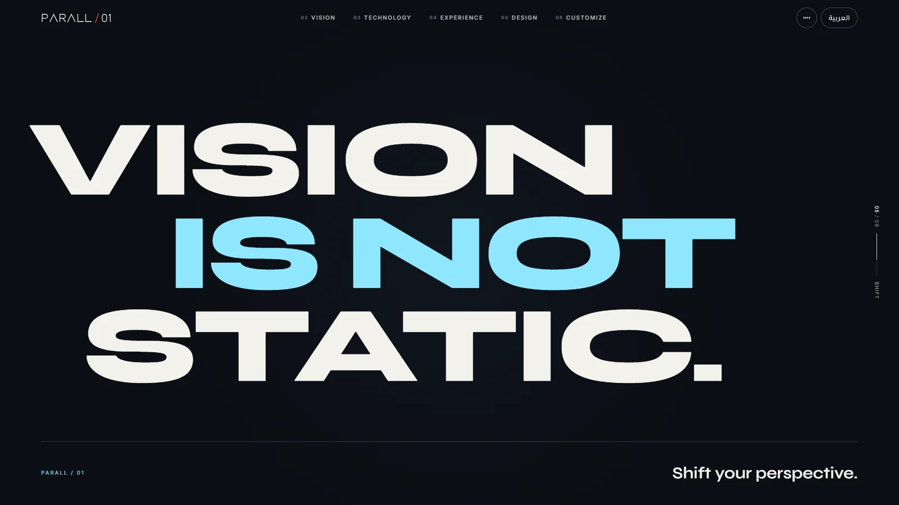</p>

## 5. 3D Product Development

The eyewear is not a downloaded asset. It is generated by a Python script for **Blender 5** (`blender/build_parall01.py`) that builds the geometry from curves, bevels and booleans, assigns named materials and exports a Draco-compressed glTF. Making the model a program meant every design revision was a reproducible change:

- **34 separately named parts** (frame, lenses, hinges, temples, compute modules, camera, status LEDs…) so the web rig can explode, fold and annotate individual components.
- **Selective density** where it is visible in close-ups — brow and endpiece bevels, the camera bezel, hinge knuckles — and relaxed sampling elsewhere: **115,164 triangles, 468 KB** as a Draco GLB with 16-bit normals.
- **A measured design correction.** An early review found the front housing too heavy. The revision was checked with identical-camera clay renders: the front-projected area dropped from 1,693 to 1,234 mm² (−27 %).
- **Clean topology for real-time shading.** Sliver caps were refined, interpenetrating shells unioned, and flat regions given smoothed custom normals, so the brushed-metal shading stays stable.

## 6. Interactive Storytelling & Motion Design

The story has one camera director. Zero-height `[data-shot]` markers inside each section say where in the scroll a composition is reached; between markers, poses interpolate with an ease. The render loop damps toward the sampled pose, so motion feels physical without ever drifting from what the scroll position dictates.

Each shot is authored as a **screen composition**, not a 3D position:

```ts
hero: { at: [0.2, 0.3], w: 0.42, hMax: 0.7, rot: [0.14, 0.62, -0.03], focus: FRONT_C }
//      where the focus point sits on screen, product width as a share of the viewport
//      width, capped by a share of its height, rotation, and which model point to frame
```

A camera-relative solve turns that into a world pose for the current aspect ratio (and mirrors it for RTL), which is why the same choreography holds on every screen in the QA matrix.

<p align="center">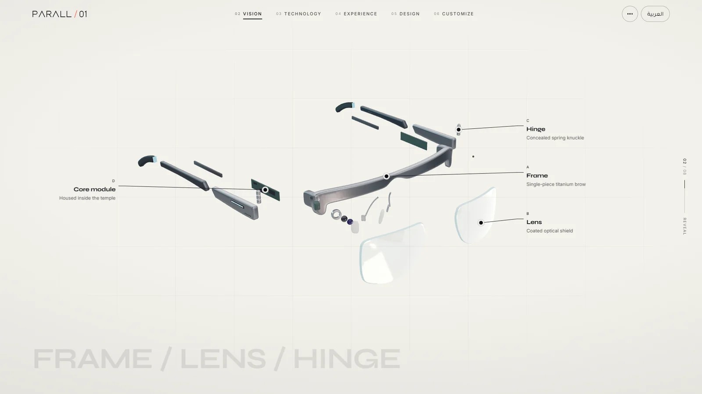</p>

## 7. GSAP and Scroll Architecture

- **Lenis** provides smooth scrolling and is driven by GSAP's ticker, so there is a single animation clock.
- **ScrollTrigger** exposes section progress and discrete steps to CSS (`--p`, `data-step`) for sticky stages. For heavy sections (the AR scene) progress is written directly to the few elements that need it, because an inherited custom property would restyle thousands of SVG nodes every frame.
- **Reversible typography** lives in one small director (`src/lib/animation/textMotion.ts`) driven by `data-motion` attributes:
  - `rise` — masked heading lines;
  - `words` — word-by-word blur-to-sharp;
  - `chars` — staggered words or characters; English only for characters, because Arabic letters must stay joined;
  - `track` — eyebrow tracking settling to its designed value;
  - `stagger` — control cascades;
  - `finale` — a scrubbed closing statement;
  - `hero-out` — the hero's exit.

  Toggle treatments play past their start and reverse above it; scrubbed ones are pure functions of scroll. The director rebuilds on language change and is disabled entirely for reduced motion.
- **Deterministic reversal.** The camera markers are re-measured whenever a layout signature (scroll height, viewport, language) changes, and the intro is derived from elapsed time, not a tween that could be killed half-way. Both fixes came from a real defect, where the hero could stay in a later shot's pose after navigating back.

## 8. WebGL Rendering & Materials

- **One persistent canvas** for the whole page — no renderer is rebuilt per section.
- **AgX tone mapping** (exposure 1.12) to match the Blender look; device pixel ratio never drops below the display's native ratio and is capped on integrated/touch GPUs, with a `PerformanceMonitor` stepping it down under load.
- **Brushed titanium** uses anisotropic physical materials with generated vertex tangents. Anisotropy is capped around 0.15–0.18 because higher values turned fine geometry into wavy bands under image-based lighting.
- **Optical glass** is two layers: a tinted lens, plus an additive coating that uses custom blend factors so it brightens the colour without writing to the canvas alpha. That keeps the page visible through the glass.
- **Theme-aware studio.** Light scenes re-bake the procedural environment as a mid-grey studio with dark flags (titanium reads silver, not gunmetal); dark scenes keep a low-key studio. A ground shadow is placed under the product's measured bounds every frame.
- **A veil that wasn't a material.** The configurator once looked washed out. The cause was a near-white atmospheric gradient layered *above* the canvas, not the materials. Moving it beneath the canvas fixed it without touching a shader.

<p align="center">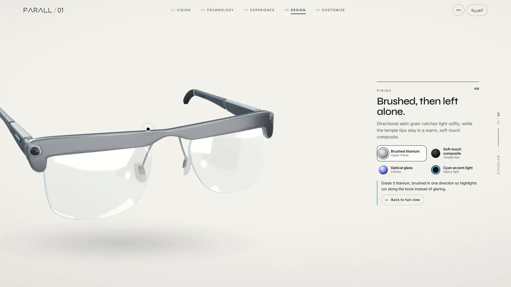</p>

## 9. AR Concept Interaction

The AR chapter opens with an iris through the lens into an original SVG plaza: an arcade, a glass pavilion with an entrance, and a skyline. Two copies of the plaza are stacked:

- **Normal view** stays clean.
- **PARALL view** adds a spatial layer: a floor mesh, a scan sweep, a route that draws itself to the entrance, tracking brackets, contextual cards with leader lines, and a translated sign. The sign's translation sits in the sign's own skewed plane, frame and label included.

That layer is a GSAP timeline. It plays when the iris opens, reverses when you scroll back, and replays on re-entry.

**Responsiveness was engineered, not assumed:**

- The comparison divider is written straight to the DOM on every pointer event. React state is only committed when the gesture ends.
- Parallax runs in one rAF loop with a short exponential follow.
- The two plazas are memoised, and no CSS transition fights the pointer.

Measured: the divider sits within **2 px** of the pointer in the same frame, and parallax reaches 95 % of its target in **≈ 225–270 ms**.

<p align="center">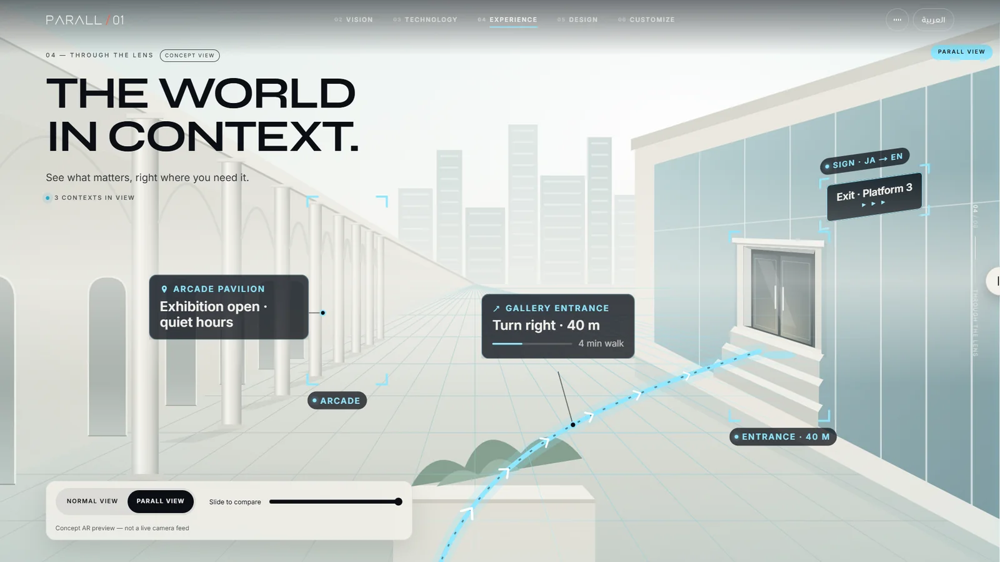</p>

## 10. Product Customization

- **Configurator.** Three finishes (Titanium, Onyx, Frost) and three tints (Clear, Ocean, Ember) mutate the same model's materials in place, eased over a few frames. Nothing is re-instantiated. The product can be rotated by drag, arrow keys or buttons, within limits, and Reset restores everything. Selections are announced to screen readers.
- **Material exploration.** Each sample in Design & Materials focuses the camera on its real component: brow, temple tip, lens or status LED.
  - The focus point is the component's position as measured in the loaded model, so the framing follows the geometry, not a hand-tuned coordinate.
  - The selected material stays true while the others recede, and a pin marks the part.
  - Back, Escape or scrolling away blends the camera back to the scroll-driven pose.
  - In Arabic, where the composition mirrors, the pin follows the mirrored counterpart part.

<p align="center">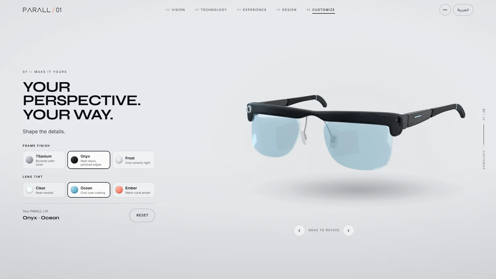</p>

## 11. Bilingual Experience & RTL Design

Arabic is a complete experience:

- **Mirroring.** `lang`/`dir` switch in place, without a reload. The 3D compositions and the AR plaza mirror; HTML text inside the mirrored plaza is counter-flipped, so it still reads correctly.
- **Type and animation.** Tajawal carries the Arabic type, with its own size curves. Text animation never splits Arabic letters, because the joining forms must survive; words are the smallest unit.
- **Exploded-view labels are laid out, not mirrored.** Each label goes in a gutter on its component's side of the product and aligns its text toward the product. Labels are spaced apart vertically, and a leader line runs to the exact part. If any label cannot sit on its own side, the view switches to lettered pins and a legend, so a leader never crosses the model.

<p align="center">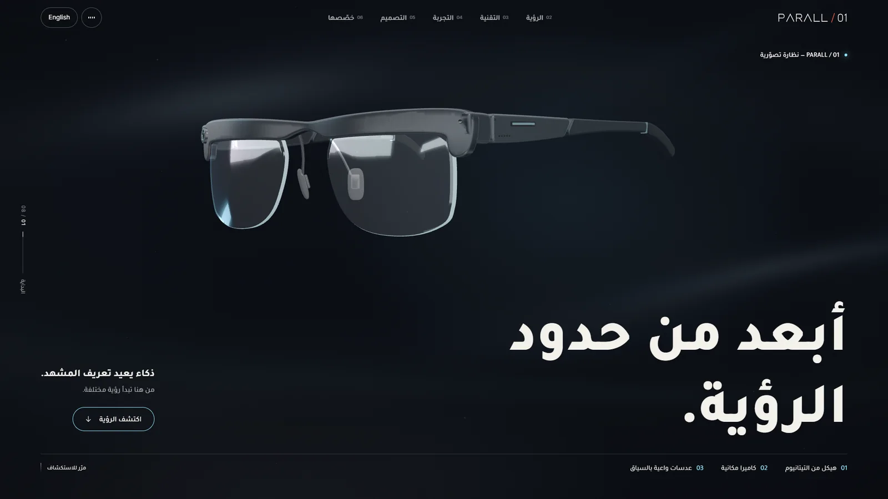 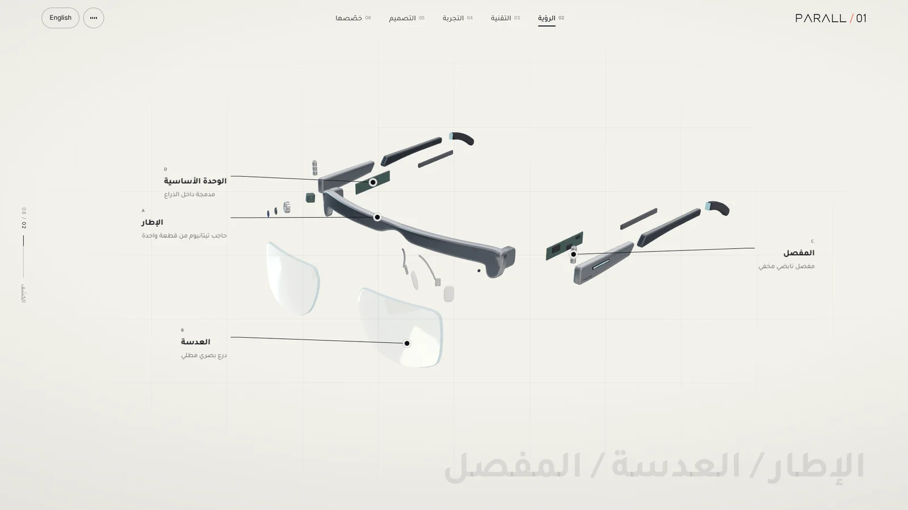</p>

## 12. Performance Engineering

The most instructive fix was the prologue freeze. The loader used to sit at 99 % and then stutter into the hero. A main-thread trace showed a **2.8 s long task** on the first visible frame of the product:

- **Wrong-variant warm-up.** A first attempt to pre-warm the GPU by rendering into an offscreen target compiled a *different* set of shader variants: render targets disable tone mapping. So that fix made nothing faster.
- **The real culprit.** A tiny camera-sensor cover in the model carried `transmission: 0.85`. That forces three.js to re-render every opaque object into a transmission buffer every frame, and to compile a second program for each of them at first sight.

The fix had three parts:

1. Render that near-black cover as glossy glass without transmission. Visually identical, and every frame is cheaper.
2. Compile programs asynchronously against the real scene (`compileAsync`, `KHR_parallel_shader_compile`).
3. Upload buffers and textures with a single-pixel, scissored warm-up draw on the real framebuffer.

The progress line is weighted, real readiness: assets, fonts, materials, shaders. It only reaches 100 % when the first product frame will not stall. In measured runs the worst frame gap after Enter dropped to roughly **0.1–0.4 s** (it was 2.8 s).

Other decisions:
- Compositor-only transforms for the scroll-linked AR camera push and the Vision rings (no layout or SVG repaint per frame); no infinite SVG animations on full-screen artwork.
- Overlays (annotations, pins, shadow) read published projections from the render loop instead of measuring the DOM per frame.
- Audio is fetched in the background and decoded off the main thread before anyone presses Enter.

**Measured frame rates** (production build, Chromium driven by Playwright, Intel UHD 630, DPR 1, 1440×900; single-machine measurements, which vary by tens of percent between runs depending on background load):

| Scene | Idle fps | Notes |
|---|---|---|
| Hero | ~45–57 | |
| Materials | ~57–60 | |
| Configurator / Finale | ~60 | |
| AR scene (pointer moving) | ~55–60 | after the compositor work above |
| Phone viewport 390×844, hero / materials | ~59 / ~59 | |

These are honest single-device numbers, not a guarantee. Faster GPUs keep the full-quality path; weaker ones scale the pixel ratio down.

## 13. Accessibility & Responsive Design

- Semantic landmarks and headings; every interactive element is a real button or input with a visible focus state; feature chips, AR slider, configurator, material samples and menu are keyboard operable.
- `aria-pressed` on toggles, `aria-current` on the active section link, live announcements for configurator and feature changes, and an accessible list version of the exploded-view labels.
- Sound is never automatic: Enter offers sound or silence, and the sound toggle reflects the real state of the audio engine.
- `prefers-reduced-motion` disables smooth scrolling, the idle float, the text director and decorative sweeps, while keeping every state readable.
- Layouts are re-composed for phones (stacked text zones, compact annotation legends, a single AR card on short screens), not scaled down. No accessibility certification is claimed; no screen-reader pass with real assistive technology has been done yet.

<p align="center">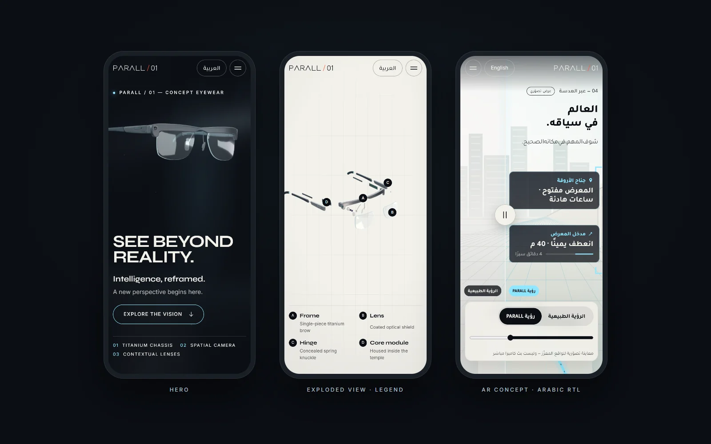</p>

## 14. Technical Challenges and Solutions

| Challenge | What was really happening | Solution |
|---|---|---|
| Product stuck in the wrong pose at the top | Shot markers measured against an older layout | Re-measure on layout-signature change; time-derived intro |
| Text colliding with the glasses on wide/short screens | Type sized by width only; product sized by height only | Width-and-height type tokens; screen-composition shots |
| Configurator glasses looked foggy | A white gradient layered above the canvas | Moved the atmosphere beneath the canvas; theme-aware studio |
| Preloader freeze at 99 % | Synchronous shader compile + a transmission pass from one material | Async compile, framebuffer warm-up, no transmission |
| Laggy AR pointer | CSS transitions on parallax layers; re-rendering both SVG plazas per move | Imperative divider, rAF parallax, memoised SVG |
| Arabic annotations overlapping parts | Labels at fixed offsets from their points | Gutter layout with collision resolution; legend fallback |
| Heading spaces vanishing in a split-text heading | Trailing spaces collapse inside inline-blocks | Words keep their space (`white-space: pre`) |

## 15. Testing & Quality Assurance

Quality was verified in a real browser, not inferred. Purpose-built Playwright suites (in `scripts/`) drive Chromium with WebGL enabled:

- **Visual matrix:** 10 viewports (1920×1080 down to 320×640, including short-desktop sizes) × English/Arabic × 14 scroll states, with a DOM audit for text overlaps, text over the product's projected silhouette, content under the navigation, off-screen content and horizontal overflow.
- **Pose determinism:** 21 navigation flows (wheel cycles, anchor jumps, mid-page resize, language switch, reload, deep link) compared against a fresh load — target pose difference 0.
- **Scroll typography:** every animated element revealed scrolling down, reversed scrolling up and replayed scrolling down again, in English, Arabic, on a phone and with reduced motion.
- **Interactions:** navigation underline timing and focus, sound on/off with measured output level, configurator material changes, AR compare (pointer, keyboard, touch), material focus for all four samples at six sizes, mobile menu.
- **Intro:** progress monotonicity, long tasks before and after Enter, audio state; fresh, cached and throttled-network loads; silent entry; reduced motion.
- **Build hygiene:** ESLint, `tsc --noEmit`, production build, and a production smoke test with no console errors.

Not covered: Safari and Firefox, real phones (touch was emulated), listening tests by ear (audio was verified by measured output) and a screen-reader pass.

## 16. Final Outcome

The finished site is a continuous, reversible product film with an original model, original sound and two fully composed languages. Every claim in this write-up corresponds to a test that was run or a change that can be read in the code.

<p align="center">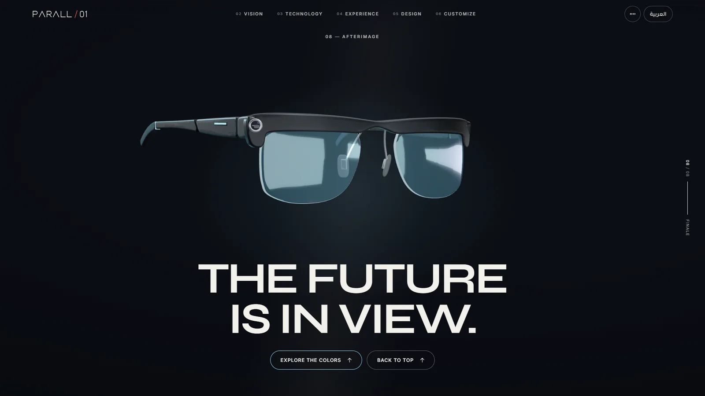</p>

## 17. Lessons Learned

- **Measure before fixing.** The two most stubborn defects — the foggy configurator and the 99 % freeze — were not where they looked to be (materials and loading). A trace and a layer audit found them in minutes.
- **Author intent, not coordinates.** Screen compositions solved per viewport outlived every layout change; hand-placed 3D positions would not have.
- **State must be a function of position.** Anything that depends on history (half-finished tweens, cached measurements) eventually breaks reversibility.
- **Arabic changes the design, not just the strings.** Annotation layout, text animation and composition all needed language-aware decisions.
- **Cheap per-frame work adds up on integrated GPUs.** Inherited CSS variables, full-screen SVG repaints and an unnoticed transmission flag cost more than the 3D model itself.

## 18. Future Improvements

- Cross-browser and real-device verification (Safari/iOS, Firefox, mid-range Android).
- A screen-reader pass and an automated accessibility audit.
- KTX2/Basis textures and per-section level of detail for lower-end devices.
- Compositor-friendly alternatives for the remaining scroll-scrubbed clip-path effects.
- A small CMS-driven content layer so copy and languages can be edited without code.

---

<p align="center"><sub>PARALL / 01 · original concept · <a href="../README.md">Back to the README</a></sub></p>
